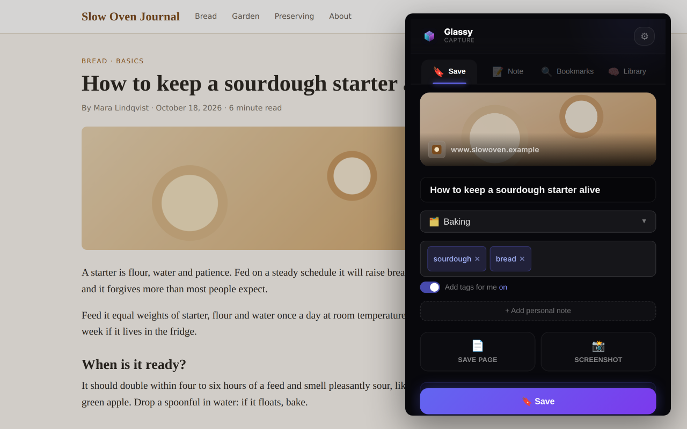
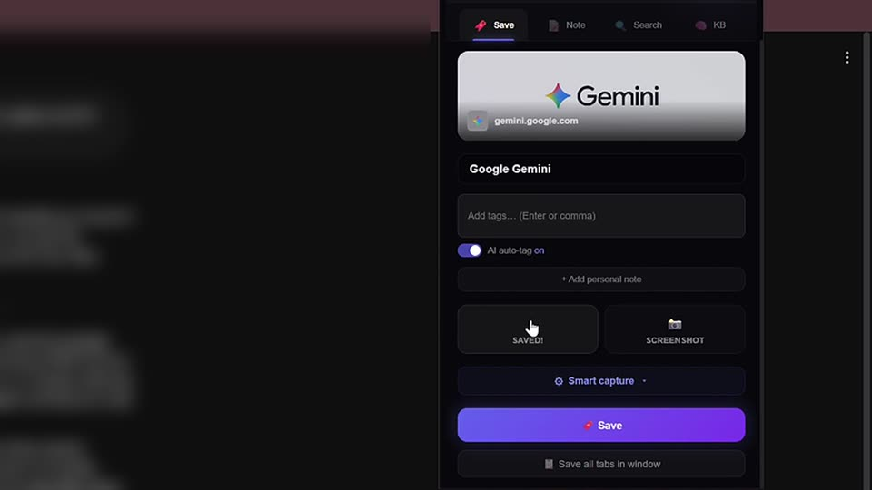
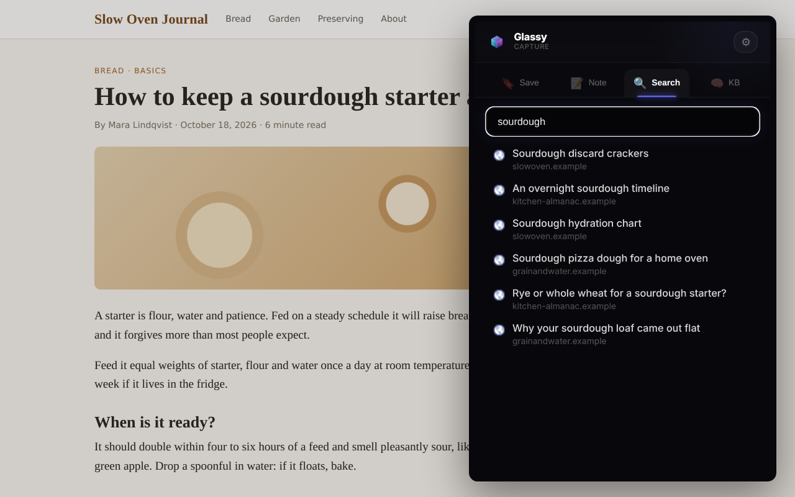
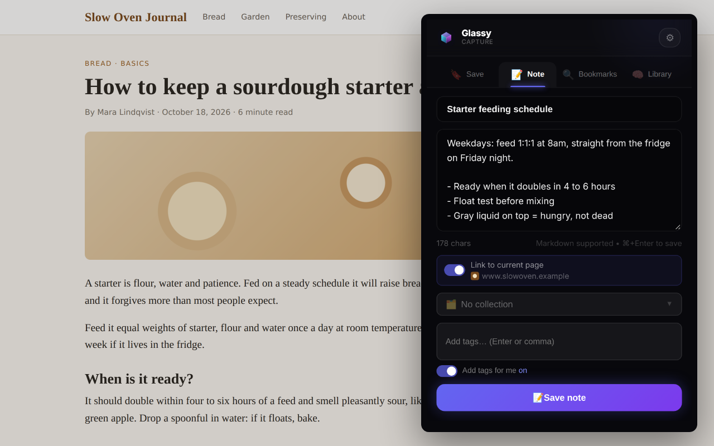
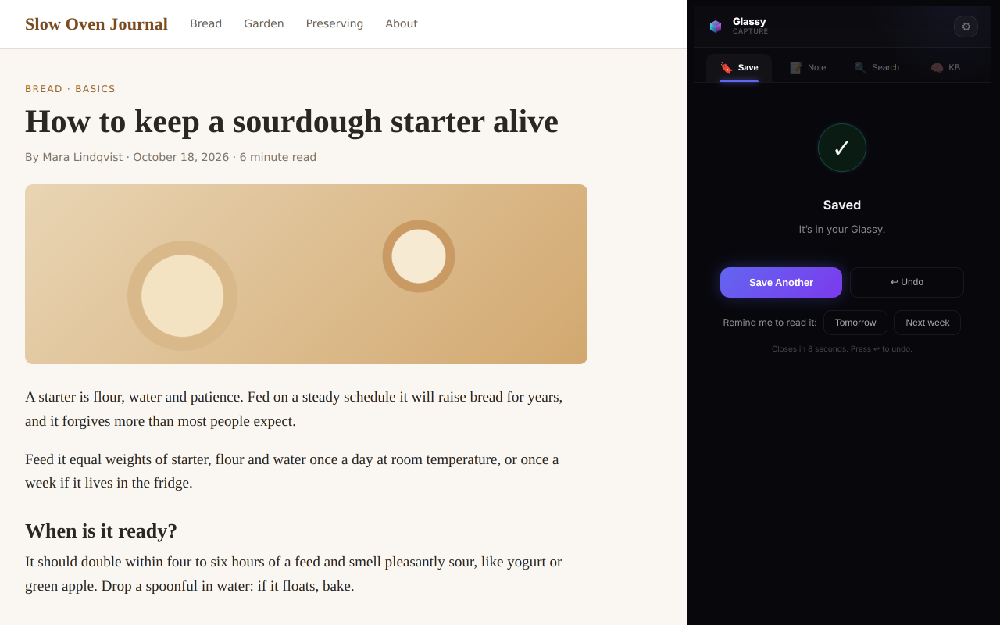

# Glassy Capture

**Save anything from the web into your Glassy, in one click, from the page you are already on.**

Pages, highlights, screenshots and quick notes land in your Glassy, tagged and searchable, where
you and your agents can find them. Free, for your Glassy on [our cloud](https://glassy.fyi) or on
[your own machine](https://github.com/0Reliance/glassy-selfhost).

[Install](#install) · [What it does](#what-it-does) · [Shortcuts](#shortcuts) · [Your own Glassy](#on-your-own-glassy) · [Privacy](#privacy) · [For AI agents](AGENTS.md)

## Install

You need a Glassy account. A free one is enough: [sign up at glassy.fyi](https://app.glassy.fyi/#/register),
or [run Glassy on your own machine](https://github.com/0Reliance/glassy-selfhost).

Download from the [latest release](https://github.com/0Reliance/glassy-companion/releases/latest).
Glassy Capture is not in the browser stores yet, so it loads in three clicks:

| Chrome, Edge, Brave, Arc or Opera | Firefox 140 or newer |
|---|---|
| 1. Download `glassy-companion-v2.21.4.zip` and unzip it. | 1. Download `glassy-companion-v2.21.4-firefox.xpi`. |
| 2. Open `chrome://extensions` (or `edge://`, `brave://`, `opera://extensions`) and turn on **Developer mode**. | 2. Open `about:debugging` and choose **This Firefox**. |
| 3. Click **Load unpacked** and choose the unzipped folder. | 3. Click **Load Temporary Add-on** and choose the `.xpi`. It stays until Firefox restarts; it isn't signed by Mozilla yet. |

Then click the Glassy icon in your toolbar and sign in with your Glassy account. On your own
machine, open the extension's settings first and set the server to your Glassy's address
(`http://localhost:3000` unless you chose another).

## What it does

<table>
<tr>
<td width="33%"></td>
<td width="33%"></td>
<td width="33%"></td>
</tr>
<tr>
<td><b>Find what you saved</b> without leaving the page, by meaning when your Glassy has a search model.</td>
<td><b>Write a quick note</b>, linked to the page you are on. Markdown works; Ctrl+Enter saves.</td>
<td><b>Saved, with undo</b>, and one tap to put "Read: this page" on your Glassy calendar.</td>
</tr>
</table>

- **One save card.** Pick what it is (article, video, repo, bookmark) and the details for that kind of page are filled in: the author of an article, the channel of a video, the stars of a repo.
- **Highlights and screenshots.** Select text and highlight it in Glassy, or capture what you can see and attach it. What you highlight and the notes you add are searchable too.
- **Tags added for you**, using only the AI your Glassy is set up with: your device, your server, your key, or AI you bought. With none, nothing is sent.
- **Saving a page you already have** offers to add the tags and note you just chose to the saved page.
- **Never loses a save.** Offline, or while your Glassy restarts, saves wait in the browser and go through once when it is back.
- **Stays signed in** for up to 90 days from when you typed your password (with Glassy 2.65.29 or newer). Changing your password signs it out.

## Shortcuts

| Do this | Windows and Linux | Mac |
|---|---|---|
| Save this page | `Ctrl+Shift+G` | `⌘+Shift+G` |
| Open Glassy Capture | `Ctrl+Shift+B` | `⌘+Shift+B` |
| Write a note | `Ctrl+Shift+N` | `⌘+Shift+N` |
| Side panel (Chrome) | `Ctrl+Shift+P` | `⌘+Shift+P` |

Change them at `chrome://extensions/shortcuts`.

## On your own Glassy

Glassy Capture works the same with a Glassy you run yourself. Set its address in the extension's
settings and sign in there. A few things are at their best at home:

- **Your Obsidian vault** in the popup: browse it, add to today's daily note, and send saves to the vault as Markdown.
- **Your agents.** Settings shows the exact setup to paste into Claude, Codex, Cursor and other agents, so what you save is there when they work.
- **Other devices.** With [Tailscale](https://tailscale.com/), point the extension at your Glassy's tailnet address (`https://glassy.<tailnet>.ts.net`) and save from any computer you use. [How to reach it from other devices](https://github.com/0Reliance/glassy-selfhost/blob/main/docs/reach-it-from-other-devices.md).

Not running your own yet? [Hand the guide to your agent](https://www.glassy.fyi/self-host): it installs
Glassy for you, free with any account. Want our cloud and your machine in step, or room to grow?
[See plans](https://www.glassy.fyi/pricing).

## Privacy

Glassy Capture talks to your Glassy and nothing else. It reads a page only when you open it or
save, collects no browsing history, and sends nothing to anyone else, including us when you run
your own Glassy. Search results show the icon Glassy saved, never one fetched from a third party.
The whole policy: [PRIVACY_POLICY.md](PRIVACY_POLICY.md).

## Questions

**Is it the same on Firefox?** Yes, except the side panel: Firefox opens the popup instead.

**Do I need AI?** No. Saving, searching by words and everything else work without it. Tags and
search by meaning use the AI your Glassy is set up with.

**Something isn't working.** Open the extension's settings and check the server address, then sign
in again. Still stuck? [Open an issue](https://github.com/0Reliance/glassy-companion/issues).

## For developers and agents

- Agents helping someone install or use it: [AGENTS.md](AGENTS.md).
- Building it, the API it uses and its history: [docs/DEVELOPMENT.md](docs/DEVELOPMENT.md), [CHANGELOG.md](CHANGELOG.md).

## License

AGPL-3.0. See [LICENSE](LICENSE). Commercial use needs a separate license from 0Reliance.
