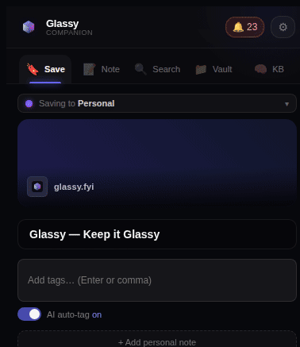
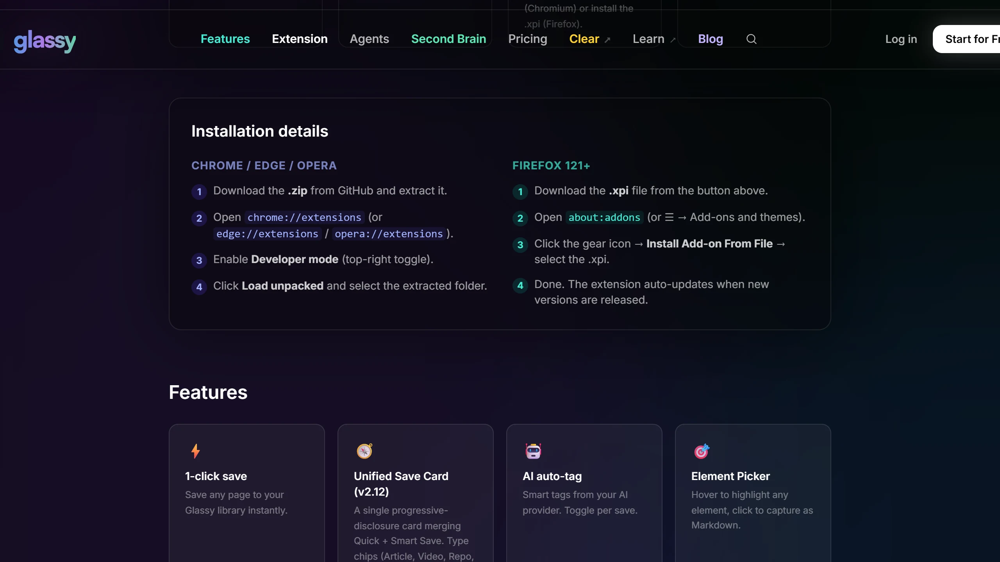
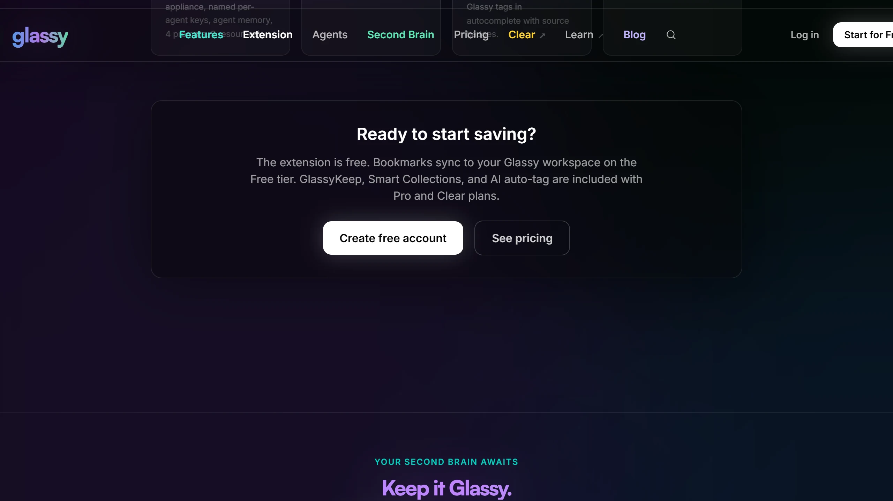
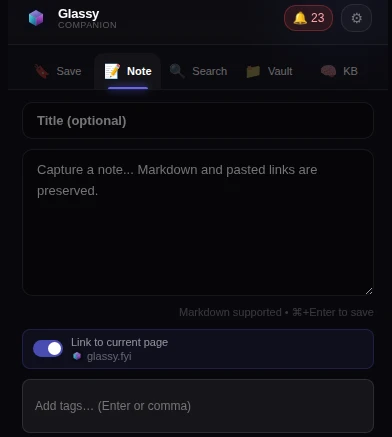
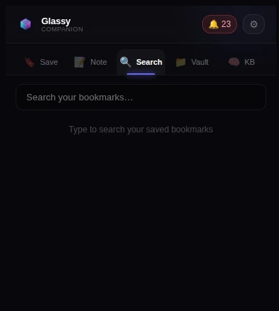
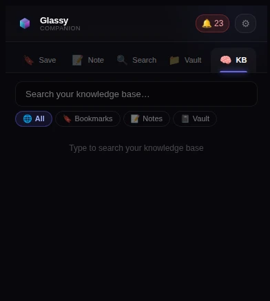
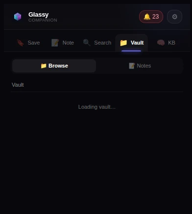
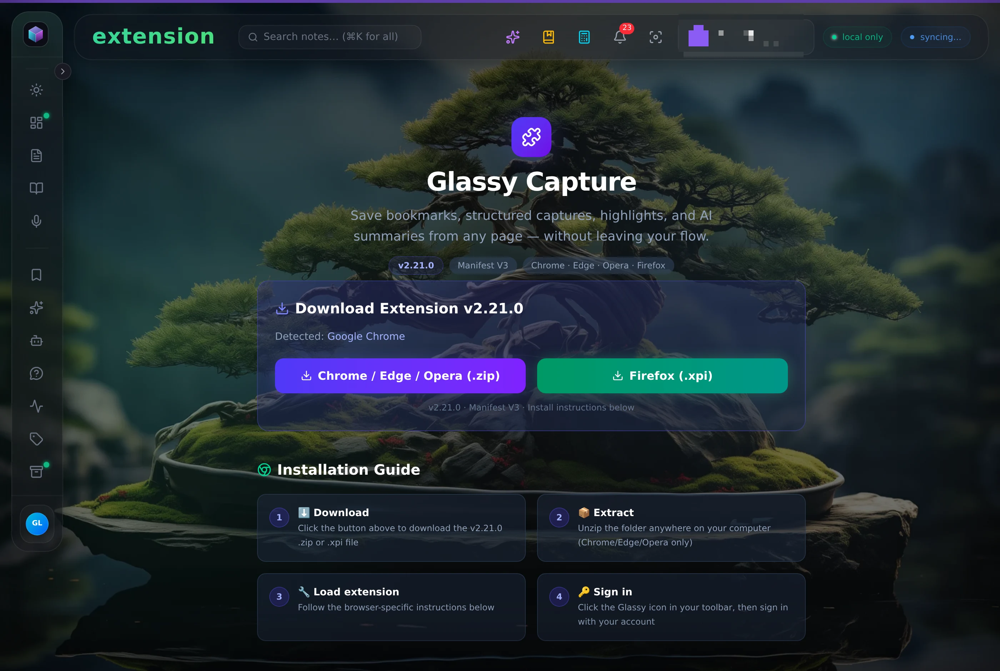
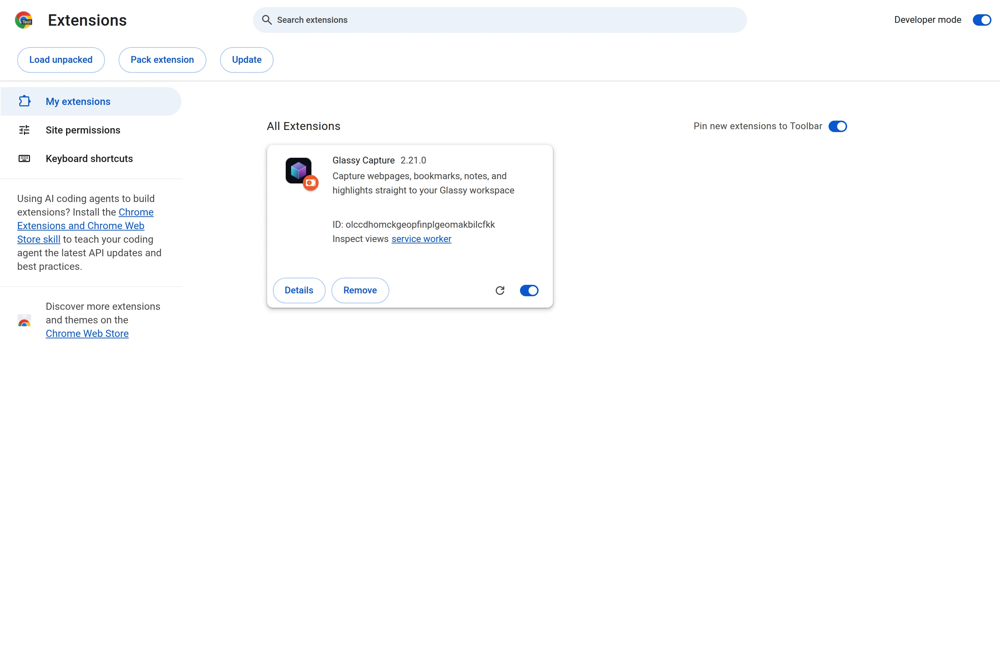

# Glassy Capture

**Save anything from the web into your Glassy workspace — in one keystroke,
from the page you're already on.**

Articles, videos, screenshots, snippets, highlights, quick notes. Premium
Markdown formatting, tags, and an offline queue that never loses a save.
Works with the cloud or with your own self-hosted appliance.

<p>
  
</p>

*Save a page, get the receipt — the capture lands in your workspace with tags and a receipt.*

<div align="left">

[](manifest.json)
[](LICENSE)

[](PRIVACY_POLICY.md)

[What it captures](#what-it-captures) · [Features](#features) ·
[Installation](#installation) · [Shortcuts](#keyboard-shortcuts) ·
[Self-hosting](#self-hosting-over-tailscale) · [FAQ](#frequently-asked) ·
[Privacy](PRIVACY_POLICY.md)

</div>

---

## 🎯 What it captures

**One card, every shape of thing.** Quick Save grabs the page as-is; Smart
Save offers four structured types (Article, Video, Repo, Bookmark) with
enriched metadata — interpreters know YouTube, GitHub, scholarly articles,
and product pages before you do anything.

<p>
  
</p>

**Your workspace receives it beautifully.** Every save arrives formatted as
premium Markdown — site metadata, author, clean headers — tagged, indexed,
and searchable in Glassy's second brain from the moment it lands.

<p>
  
</p>

**It respects the reader.** The content script sits dormant until you save.
No tracking, no history collection, no third-party calls — everything goes to
your Glassy server and nowhere else ([privacy policy](PRIVACY_POLICY.md)).

### A tour, in four shots

<p>
  
  
  
  
</p>

- **Note** — a Markdown composer, linkable to the page you're on. ⌘+Enter saves.
- **Search** — your saved bookmarks, a keystroke away.
- **KB** — the workspace's knowledge base (notes, vault files, documents) from
  the extension; semantic search, no new tab needed.
- **Vault** — browse your Obsidian vault from any page, through the bridge.

---

## Features

| Feature | Description |
| --- | --- |
| **Unified Save Card (v2.12.0)** | A single progressive-disclosure capture card merging Quick Save and Smart Save. Type chips (Article, Video, Repo, Bookmark) re-run the page interpreter on change so metadata is always fresh before save. One card, one flow, less friction. |
| **Quick Save** | Instant, one-click save of the current page with premium Markdown formatting. |
| **Smart Save** | Structured capture with 4 content types (Article, Video, Repo, Bookmark). Type chips re-run the page interpreter on change so metadata is always fresh before save. |
| **Element Picker** | Click any element on the page to capture it as rich Markdown. Hover-to-highlight with purple glow. (Deferred from main bar in v2.9.0 — available as a future in-reader affordance.) |
| **Screenshot Capture** | Capture the visible viewport via direct service worker routing (`captureVisibleTab`). Works on restricted URLs, PDFs, and stale tabs where the content script is absent. |
| **Site Interpreters** | Automatic enriched metadata for YouTube, GitHub, product pages, and scholarly articles via Schema.org. |
| **Content Preview** | Preview extracted page content as rendered HTML or raw Markdown before saving. See word count and reading time. |
| **Side Panel** | Persistent side panel (Chrome, `Ctrl+Shift+P`) that stays open while you browse. Firefox falls back to popup. |
| **Read It Later (v2.21.0)** | After a save, one tap adds "Read: <page>" to your Glassy calendar for tomorrow or next week at 9:00. With calendar sync, it shows on every Glassy you pair. |
| **Tag Intelligence** | Local tag frequency tracking ranks suggestions by usage. Keyword extraction fallback when AI is unavailable. |
| **Duplicate Check** | Instantly see if a page is already saved with a green "Already saved" banner. |
| **Undo Save** | Delete a capture within 8 seconds of saving — no need to open Glassy. |
| **Premium Presentation** | Every save is formatted with a high-fidelity Markdown layout including site metadata, author info, and clean headers. |
| **Highlights** | Select text to capture it as a first-class highlight with CSS selector persistence. |
| **Glassy Design** | A beautiful, layered Obsidian theme with luminous indicators and glass-morphic UI. |
| **Rule Engine** | Automatic preset assignment based on domain and URL patterns from your Glassy dashboard. |
| **Offline Queue** | Saves are queued locally if your Glassy instance is unreachable and sync automatically. |
| **Library Search (v2.10.0, one search since v2.21.0)** | Search your notes, docs, bookmarks, voice and vault from the popup, with Glassy's one search: meaning first, lifted by your words. A result opens the item itself on your Glassy. Says plainly when it is matching by words only. |
| **MCP Bridge config (v2.11.0)** | Settings → Integrations shows copy-pasteable Claude Desktop / Cursor config snippets with the live server URL — pair with the Glassy MCP server (glassy-dash v2.35.0-beta.7+). |
| **Cross-Browser** | Full Chrome and Firefox support. Accessibility: focus indicators, reduced motion, high contrast. |
| **Storage quota monitoring (v2.11.0)** | Periodic alarm checks `chrome.storage.local` usage; warns at 80%, auto-trims the offline queue at 95% critical. |
| **Obsidian Bridge (v2.12.0, reliability fix v2.13.0)** | Proxy Obsidian Local REST API requests on behalf of the Glassy server. Solves WSL2/Docker networking — the extension runs on the host and can reach `127.0.0.1:27124` directly. Also pushes captures to the vault as markdown files. v2.13.0 moved the SSE connection to a persistent offscreen document so Chrome MV3 service worker eviction no longer silently kills the bridge. |
| **Push-to-Obsidian (v2.12.0)** | Captures saved via the extension are automatically pushed to the Obsidian vault as markdown files with YAML frontmatter — no server round-trip needed. |

---

---

## Integration Surface

- **Canonical capture API:** `POST /api/captures`, `GET /api/capture-rules`, `PATCH /api/items/:id`, `POST /api/items/:id/promote`
- **Supporting extension API:** `/api/ext/*` remains in use for auth, bookmarks, notes, tags, collections, search, documents, and reminders (`/api/ext/calendar/events`).
- **Account-aware requests:** extension calls include `X-Account-Id` when an active account is selected.
- **Offline replay:** queued bookmark, note, capture, and page/document saves retry automatically when connectivity returns.

---

---

## Installation

The whole flow, in two shots:

<p>
  
</p>

<p>
  
</p>

1. Go to [**Releases**](https://github.com/0Reliance/glassy-companion/releases).
2. Download the latest `v2.21.1` assets:
   - **`glassy-companion-v2.21.1.zip`** for Chromium browsers (Chrome, Edge, Brave, Arc, Opera). Unzip and load the folder as an unpacked extension.
   - **`glassy-companion-v2.21.1-firefox.xpi`** for Firefox 140+. Install via `about:addons` → gear icon → Install Add-on From File.
3. For Chromium: open `chrome://extensions`, enable **Developer mode**, and click **Load unpacked**. Select the unzipped folder.

### Browser Support

- **Chromium** (Chrome, Edge, Brave, Arc, Opera): install from `glassy-companion-v2.21.1.zip`.
- **Firefox 140+**: install from `glassy-companion-v2.21.1-firefox.xpi` for local/user testing via `about:addons`. Chrome Web Store and Mozilla Add-ons submission are the next distribution steps (see Project state below).

> Both builds are produced from the same source. The Firefox build uses a separate manifest (`manifest.firefox.json`) with the required Gecko extension ID, `strict_min_version: 140.0`, its `data_collection_permissions` declaration, and the AMO-required `content_security_policy`.

---

---

## Keyboard Shortcuts

| Action | Shortcut |
| --- | --- |
| Quick Save | `Ctrl+Shift+G` |
| Open Popup | `Ctrl+Shift+B` |
| Quick Note | `Ctrl+Shift+N` |
| Toggle Side Panel | `Ctrl+Shift+P` (Chrome only) |

---

---

## Self-hosting over Tailscale

[Tailscale](https://tailscale.com/) is a WireGuard mesh that lets the extension
reach a self-hosted Glassy instance from any device on your tailnet — phone,
laptop, tablet — without port forwarding or public exposure. The extension
connects to whatever **Server URL** you enter in Settings; `https://glassy.tailnet.ts.net`
works identically to `http://localhost:3000`. No extension code changes are needed —
`*.ts.net` has been in the extension's URL allowlist (alongside localhost and
RFC1918 private ranges) since v2.12.0.

### The Obsidian bridge becomes optional

The bridge exists because the Glassy container cannot reach `127.0.0.1` on your
host. **Tailscale changes the architecture:** when Glassy and Obsidian are both
on the tailnet, the server reaches Obsidian directly via the tailnet IP — no SSE
connection, no MV3 service worker, no browser dependency. The entire class of
bridge reliability issues (SSE cycling, offscreen eviction, WSL2 networking,
auth ticket races) does not apply.

The bridge remains the canonical path for WSL2 (where the container cannot reach
the Windows host) and for setups where Obsidian is not on a tailnet.

### Cross-machine use case

Extension on laptop, Glassy on homelab/NAS — Tailscale makes this smooth.
Run Glassy on the homelab, install the extension on your laptop, point it at
`https://glassy.tailnet.ts.net`, and capture from anywhere on your tailnet.

See the [self-host README § Multi-device access](https://github.com/0Reliance/glassy-selfhost#multi-device-access)
for `tailscale serve` setup and the sidecar overlay for headless servers.

---

---

## Frequently asked

**Does it work with my self-hosted appliance?**
Yes — that's the point. Point the extension's server setting at your appliance
(`http://localhost:3010`, or your Tailscale hostname) and sign in there. Cloud
and appliance are both supported; you pick.

**Does it replace my notes app?**
No. It captures *into* your workspace — Glassy (the web app) holds the notes.
It is not a replacement for your editor, and it is not an Obsidian replacement:
it works *with* your vault through the Obsidian bridge.

**Firefox?**
Yes, Firefox 140+ — install from the `.xpi`. Firefox falls back to the popup
instead of the side panel; everything else is the same.

**Where does my data go?**
To your Glassy server, over HTTPS, and nowhere else. The extension does not
track your browsing, makes no third-party calls, and reads a page only when
you invoke a save. See [PRIVACY_POLICY.md](PRIVACY_POLICY.md).

**Do I need AI?**
No. Capture works without it. AI auto-tagging is optional and can be turned
off, and you can run a model on your own machine if you want one.

---

## Development

**Prerequisites:** Node.js 20+, npm 9+

```bash
npm install
npm run dev              # Watch mode (Chrome)
npm run build            # Production build → dist/
npm run build:firefox    # Firefox build → dist-firefox/
npm run zip              # Package Chrome → glassy-companion-v*.zip
npm run zip:firefox      # Package Firefox → glassy-companion-v*-firefox.xpi
npm test                 # Run unit tests (258 tests)
```

---

---

## Project state

Repo-local release and distribution state lives here, with the full history in
[CHANGELOG.md](CHANGELOG.md).

**Current state (November 12, 2026):** v2.21.1 is v2.21.0 made ready for the
browser stores: it asks for less (two retired addresses are gone from its host
access), the Firefox build says what it sends and needs Firefox 140, and the
store listing, privacy policy, screenshots and a paste-from sheet
([STORE_SUBMISSION.md](STORE_SUBMISSION.md)) are in the repo. It works the same. v2.21.0 (November 10) — search speaks Glassy's one
search, and a save can remind you to read it. The Knowledge Base tab searches
notes, docs, bookmarks, voice and vault with the server's own source names (the
Vault filter used to return everything), a result opens the item itself on your
Glassy in a new tab, and the tab says plainly when it is matching by words only.
After a save, one tap adds "Read: <page>" to your Glassy calendar for tomorrow
or next week at 9:00; with calendar sync it shows on every Glassy you pair. The
AI summary, whose screen was removed in v2.9.0, is no longer advertised, and the
save, search, settings and agent-key messages are rewritten in plain words.
Requires glassy-dash ≥ v2.40.5; the search tabs match Glassy 2.63 or later, and
reminders need a Glassy from September 2026 or later. Remaining: the upload
to the Chrome Web Store, Firefox Add-ons and Edge Add-ons, which needs the
owner's developer accounts.

---

## Current compatibility and distribution (November 10, 2026)

- Companion is **v2.21.1**. The source manifest, Chrome/Firefox build
  manifests, and local v2.21.1 ZIP/XPI manifests agree. Older archives are
  historical outputs, not evidence that the current build is v2.11.0.
- Use Glassy's newest released versioned appliance image for the latest
  server-side fixes — **v2.65.16** as of November 10, 2026 (check the
  [appliance releases page](https://github.com/0Reliance/glassy-selfhost/releases) for the
  current tag). `:latest` / `:main` are hosted builds; `:selfhost-main`
  is a floating appliance build for testing. **v2.40.2 or newer is required for
  this companion release**: the server contract reads `capabilities.mcp.mounted`
  (added by glassy-dash #125 in v2.40.2) and `capabilities.vault` (added in
  v2.40.5). Against an older appliance both fail closed, so the AI Tools and
  Vault surfaces stay hidden rather than guess — and the much older
  `v2.36.0-beta.40` image this README previously recommended has no
  `/api/capabilities` endpoint at all. The v2.52.x–v2.65.16 server waves
  (sync cycle contract, embeddings namespace model, the pair token as a
  Settings value, one search everywhere, agents' own space, calendar sync) kept
  the extension's `/api/ext/*` + `/api/captures` request and response shapes, so
  no companion release was needed for them. One thing a person may notice: the server’s
  error messages there are rewritten in plain words (status codes and `code`
  values unchanged). The extension doesn't call AI summary (`/api/ext/ai/summarize`),
  which as of v2.65.16 draws on Glassy AI credits unless the person uses their own key.
  The Knowledge Base tab's Vault filter, which sent a source name v2.63's one search
  no longer knows, is fixed in v2.21.0.
  Capture content that used to be
  embedded server-side now converges through the owner's next visit when the
  first-party embedding shim is retired — the extension is an arrival lane, not
  the embedder, by design.
- Recent server improvements include canonical note types, KB search diagnostics,
  working BYOK configuration and live Ollama model selection, and LAN agent
  connections on appliances. These do not imply new extension permissions.
- Cloud Sync downloads supported missing media on appliance pull cycles; it
  is not the extension's offline capture queue or bidirectional file backup.
  See [Cloud Sync](https://docs.glassy.fyi/02-core-features/cloud-sync/).
- KB, MCP and Agent Gateway remain appliance-only. Use the advertised MCP
  schema rather than treating capture categories as canonical note types.
- Local archives are not proof of store publication. Chrome Web Store and
  AMO upload/approval remain a separate authenticated release step; this
  documentation pass does not claim they were completed.


---

---

## License

AGPL-3.0 — see [LICENSE](LICENSE) for details.

Commercial use requires a separate license from 0Reliance.
